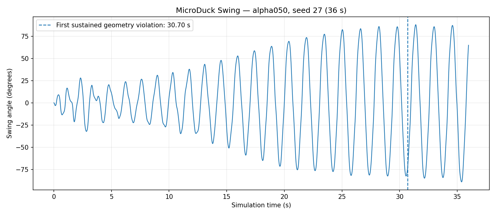
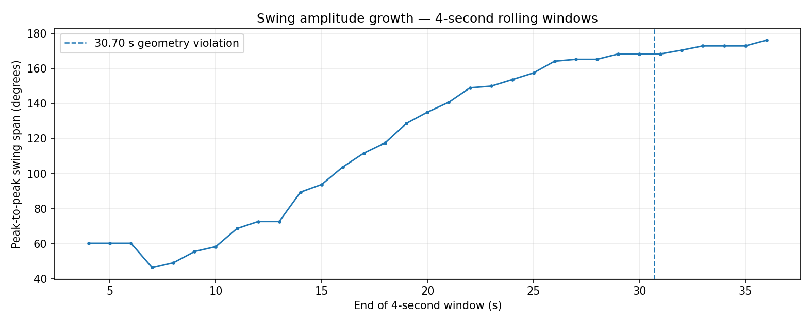

# Task 4 — MicroDuck 摆动旋转强化学习复现实验报告

> Datawhale Every-Embodied · `04-MicroDuck摆动旋转强化学习复现`
> 实验数据：`swing_seed27.json`（本地提供的 `swing_seed27(1).json`）
> 分析日期：2026-10-20
> 源模型：`experiments/swing/checkpoints/alpha050.pt`
> **核心结论：成功观察到主动泵摆的摆幅增长，但本次 seed 27 不满足全程严格几何有效性。**

## 1. 任务目标

MicroDuck 安装在双绳悬挂的秋千上，通过关节和头部动作，在不依赖外部初始推力或预设摆动相位的条件下使摆幅增大。任务不仅检查摆幅，还检查横向稳定性、绳索几何、执行器限制和策略与 ONNX 的行为一致性。

本报告基于**实际上传的 36 秒评估 JSON**。其中的数字是本次实验数据，而不是照抄官方演示视频。后文中的官方参考值只用于比较，不能混作本机测试结果。

## 2. 实验对象与方法

- 环境：`Mjlab-SwingPump-MicroDuck`，MuJoCo / mjlab，WSL2 Ubuntu（据本次实验流程）。
- 公开 actor checkpoint：`experiments/swing/checkpoints/alpha050.pt`。
- 物理评估运行时间：**36 秒**；控制步长 `0.02` 秒（50 Hz），共 **1800** 个数据采样点。
- 实验 seed：**27**（沿本次实验命令配置；请同时保留运行命令和日志）。
- PPO smoke test：此前已反馈执行了 `64` 个环境、`5` 次迭代；**尚未收到该训练任务的完整日志和检查点，不能据此报告训练收敛或特定 reward**。
- ONNX 模型导出、完整 parity 测试和自录 MP4 的最终文件尚未在本次附件中核实，不能声称它们通过。

## 3. 摆动运动结果

| 指标 | 本次实测值 |
|---|---:|
| 整段最大正摆角 | +88.05° |
| 整段最大负摆角 | -89.05° |
| **整段最大峰峰摆幅** | **177.11°** |
| 最初 4 s 的峰峰摆幅 | 60.20° |
| 最后 4 s 的峰峰摆幅 | 176.21° |
| 首末窗口峰峰摆幅增长 | **116.02°** |
| 最后 6 个半周期的平均峰峰摆幅 | 171.62° |
| 最大等效能量高度 | 1.228 m |



图 1：36 秒内的逐时刻摆角；竖虚线标记首次触发连续几何违规的时刻。



图 2：4 秒滑动窗口中的峰峰摆幅随时间变化。

**分析：** 摆幅从开始阶段的约 60.20° 增长至末尾窗口的约 176.21°，表明公开 actor 确实表现出持续泵摆和能量积累的效果。该结果表示左右两个方向的峰值差，**不能解读成完成 177° 单侧摆角，更不能说完成了连续 360° 翻环**。

## 4. 物理有效性审计（最重要）

| 项目 | 本次值 | 解读 |
|---|---:|---|
| 首次连续严格门控违规 | **30.7 s** | 后 5.3 s 不能计作全程无几何债务 |
| 全程无几何债务 | **`false`** | **严格物理有效性未通过** |
| 最大横向位移 | **46.45 mm** | 存在较明显的横向运动 |
| 最大挂点对齐惩罚 | **0.2367** | 高于 0.05 约束门槛 |
| 绳长最小值 | 0.3630 m | 可能存在松弛，应结合双绳状态判断 |
| 绳长最大值 | 0.3920 m | 未超过严格上限 0.394 m |
| 原始动作被裁剪比例 | **77.29%** | 策略很多动作超出允许幅度，已被裁剪 |
| 任一关节电流受限的控制步比例 | 15.17% | 说明执行器限制并非可忽略 |

### 4.1 首次违规机制：30.68–30.70 秒

根据当前固定版本 `scripts/evaluate_swing_checkpoint.py`，一次控制采样违反任一几何门槛（横向位移绝对值超过 0.020 m、挂点对齐惩罚超过 0.050、两绳最大长度超过 0.394 m 或两绳最大长度低于 0.370 m）视为无效；**连续两个无效采样**即触发几何债务。

在本次 50 Hz 数据里：

| 时刻 | 挂点对齐惩罚 | 是否越过 0.050 |
|---|---:|---|
| 30.66 s | 0.04720 | 否 |
| 30.68 s | 0.05168 | 是（第 1 次） |
| 30.70 s | 0.05190 | 是（第 2 次） |
| 30.72 s | 0.05032 | 是 |

因此 `first_sustained_exact_gate_violation_s = 30.7` 与原始逐步数据一致。**第一次触发来自挂点对齐惩罚连续超限**，并非摆角本身过大就自动算失败。

### 4.2 与官方参考值的区别

官方 `alpha050` 选择记录的 **seed 27 最佳严格通过回放**峰峰摆幅约 **173.20°**，最大横向偏移 **10.35 mm**，并统计 100 个 seed 中 **71 个**完成严格全时域通过。

本次结果的峰峰摆幅 **177.11°** 虽然高于参考数字，但最大横向偏移达 **46.45 mm**，且第 30.70 秒触发几何债务，所以**不能把更大的摆幅宣称为策略优于官方版本或更成功**。两次回放的运行环境、随机状态等可能不同；需要在一致条件下复测才能归因。

## 5. 策略与训练说明

本实验区分三个不同概念：

1. **公开策略评估**：`alpha050.pt` 的 36 秒仿真和 JSON 物理审计。本报告的量化数据全部来自这一步。
2. **ONNX 导出及 parity**：检查导出的 ONNX 是否保留 observation normalizer 与动作裁剪，并沿完整 rollout 对比 PyTorch actor；**此次上传附件不能确认 parity 最终状态**。
3. **PPO smoke test**：本机进行过 64 环境、5 次迭代的运行（根据操作者反馈）；只作为训练通路验证，**不能写成从零训练出公开高摆幅策略**。

建议将终端日志与自录 MP4 上传后补充完成证据。

## 6. 实验限制与后续改进

- 本结果来自单个 seed 27，不能代替多 seed 的统计鲁棒性结论。
- 高摆幅后期出现挂点对齐误差、横向运动和动作裁剪；后续可重点分析 30–36 s 的物理状态，并检验奖励和几何约束如何影响策略输出。
- 推荐复现官方评估配置并对多个随机种子做相同指标比较；同一指标需要同时报告幅度和几何有效性。
- 目前没有真机验证证据；仿真约束通过也不等于机器人硬件安全。

## 7. 原始证据与复现命令

原始上传文件：[swing_seed27.json](../results/swing_seed27.json)（将本机原始 JSON 复制或重命名到 `results/` 后链接才有效）。

```bash
cd ~/projects/microduck-stilts
uv run python scripts/evaluate_swing_checkpoint.py \
  experiments/swing/checkpoints/alpha050.pt \
  --output /mnt/c/Users/LXH20/Desktop/Microduck/results/swing_seed27.json \
  --device cpu --duration 36 --seed 27
```

如果已导出 ONNX，可执行：

```bash
uv run python scripts/verify_swing_onnx_parity.py \
  experiments/swing/checkpoints/alpha050.pt \
  artifacts/swing/microduck-swing.onnx \
  --device cpu --duration 36 --seed 27
```

## 8. 参考资料

- [Datawhale Every-Embodied Task 4](https://github.com/datawhalechina/every-embodied/tree/main/16-专题组队学习/05-MicroDuck运动策略与任务开发专题/01-任务资料/04-MicroDuck摆动旋转强化学习复现)
- [Vottivott/microduck-playground](https://github.com/Vottivott/microduck-playground)
- [Swing experiment](https://github.com/Vottivott/microduck-playground/tree/c5fcc50219fef01ac9931d0079c583ccbb29b689/experiments/swing)
- [HannesVonEssen/microduck-swing](https://huggingface.co/HannesVonEssen/microduck-swing)
