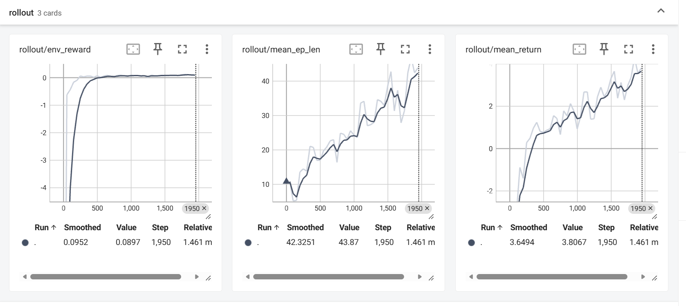
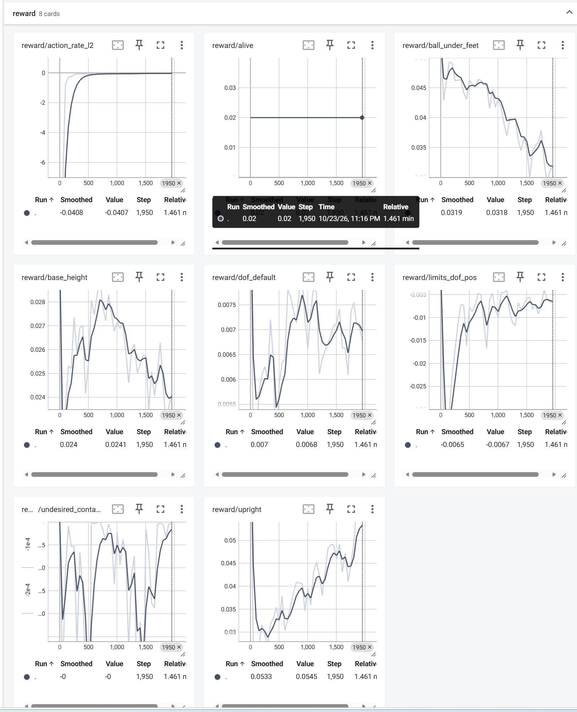
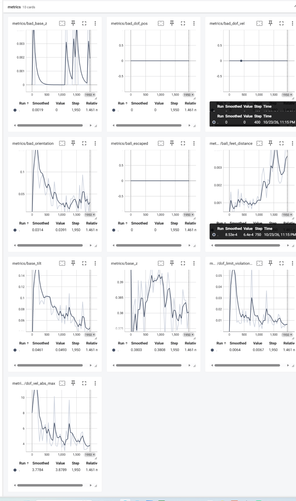

# Task 5 — MotrixLab MicroDuck 球平衡与 FastSAC 复现报告

> Datawhale Every-Embodied · MicroDuck 运动策略与任务开发专题 · 2026-10-23  
> 实验类型：官方任务复现、FastSAC 小规模训练与回放；**非完整收敛或跨种子成功率基准**。

## 1. 实验目标与结论

本实验用 MotrixLab 自带的 `microduck-ball-balance` 环境和 **Motrix FastSAC**，验证球平衡任务的环境初始化、CUDA 训练、策略保存、视频回放和 TensorBoard 指标链路。对比此前使用 PPO 的 MicroDuck 平衡实验，本任务采用不同的仿真器与观测接口，不宜将二者的 reward 直接等同。

**结论：**成功完成 20-iteration smoke test 和一轮新的、目标为 2,000 iterations 的同步 FastSAC 训练，保存 checkpoint，并生成第二轮模型的 10 秒视频。训练后期的平均回合长度在 TensorBoard step 1950 时为 **43.87 控制步（约 0.877 秒）**，平均回合累计 return 为 **3.8067**。虽然奖励与回合长度均有上升趋势，但现有数据**不能证明连续站稳 10 秒**。完成课程复现报告**不需要强制续训到 5,000 次**；若目标是长期稳定性，应另设训练及独立评估。

## 2. 环境与实现

| 项目 | 本次配置 / 依据 |
|---|---|
| 系统 | Windows 主机 + WSL2 Ubuntu |
| GPU | NVIDIA RTX 3060 Laptop（6 GB） |
| 项目 | [Motphys/MotrixLab](https://github.com/Motphys/MotrixLab) |
| 任务 | `microduck-ball-balance/motrix.fastsac` |
| 仿真与算法 | MotrixSim / Motrix FastSAC；同步训练回退路径 |
| Actor / value 观测 | 54 / 63 维（官方任务配置） |
| 动作 | 14 个关节位置目标 |
| 控制周期 | 0.02 s（50 Hz） |
| Python | uv 安装的 Python 3.10 环境，从 traceback 可见 |
| 精确仓库 commit | **未采集**；复现实验应补录 `git rev-parse HEAD` |

MotrixLab 官方任务把外观类似西瓜的纹理球建成一个自由滚动刚体；这不是经真实西瓜质量、惯性与接触参数标定的物理模型。

## 3. 已执行实验

### 3.1 首轮 smoke test（20 次）

配置：64 并行环境、`batch_size=256`、`num_updates=1`、同步 FastSAC、禁用 Torch 编译和 AMP，目标 20 iterations。训练保存：

```text
runs/microduck-ball-balance/motrix/torch/fastsac/
26-10-23_22-58-44-234681/checkpoints/latest.pt
```

此模型已成功载入回放环境，完成一次 10 秒 MP4 生成。未得到独立站立成功率。

### 3.2 第二轮训练（目标 2,000 次）

```bash
cd ~/projects/MotrixLab
WANDB_MODE=disabled .venv/bin/mxlab train \
  task=microduck-ball-balance/motrix.fastsac \
  num_envs=128 \
  play_num_envs=4 \
  algo.asynchronous=false \
  algo.trainer.num_learning_iterations=2000 \
  algo.agent.batch_size=512 \
  algo.agent.num_updates=2 \
  algo.agent.compile=false \
  algo.agent.amp=false \
  logging.interval=50 \
  checkpoint.interval=500 \
  play=false
```

这一轮从零开始，而非从 20 次的 checkpoint 继续训练。训练器记录并保存了：

```text
runs/microduck-ball-balance/motrix/torch/fastsac/
26-10-23_23-14-17-110878/checkpoints/latest.pt
```

训练页显示到 step 1950，并非直接提供 2000 step 处的全部标量。已用这份 checkpoint 成功生成 10 秒回放视频（附件）。

### 3.3 已验证的回放命令

```bash
.venv/bin/mxlab play \
  env=microduck-ball-balance \
  policy=runs/microduck-ball-balance/motrix/torch/fastsac/26-10-23_23-14-17-110878/checkpoints/latest.pt \
  num_envs=1 \
  record_video=true \
  record_seconds=10 \
  record_width=720 \
  record_height=720
```

**视频：** [FastSAC 2,000 次训练模型回放（10 秒）](../media/Task5_FastSAC_2000iter.mp4)。画面中存在姿态倾斜与回到接近直立状态的变化；不能排除仿真中的自动重置，不能仅凭片长推断 10 秒连续成功。


## 4. TensorBoard 训练结果

### 4.1 Rollout（step 1950）

| 指标 | 原始 Value | 平滑值 Smoothed | 解释 |
|---|---:|---:|---|
| `rollout/mean_ep_len` | **43.87 steps** | 42.3251 | 平均回合长度 |
| `rollout/mean_return` | **3.8067** | 3.6494 | 平均回合累计奖励 |
| `rollout/env_reward` | **0.0897** | 0.0952 | 记录的环境奖励指标 |

按 `control_dt = 0.02 s` 换算：`43.87 × 0.02 = 0.8774 s`。曲线显示回合长度从训练初期约 10 steps 逐步上升；初期读数为**截图估算**，不是原始 CSV 数据。



### 4.2 Reward（step 1950）

以下采用截图中各卡片的 **Smoothed** 值（与原始 Value 不应混淆）。

| 指标 | 平滑值 | 趋势判断 |
|---|---:|---|
| `reward/upright` | 0.0533 | 上升，直立能力相关奖励改善 |
| `reward/ball_under_feet` | 0.0319 | 下降，球与足部相对位置控制可能是瓶颈 |
| `reward/action_rate_l2` | -0.0408 | 负惩罚趋近于 0，动作变化趋缓 |
| `reward/limits_dof_pos` | -0.0065 | 负惩罚幅度减小 |
| `reward/base_height` | 0.0240 | 中期升高、后期下降 |
| `reward/dof_default` | 0.0070 | 小幅波动 |
| `reward/alive` | 0.0200 | 维持不变；不能单凭此项认定存活率高 |



### 4.3 环境状态与物理指标

`metrics/base_tilt` 后期总体下降，末端显示值约 0.0493；`metrics/bad_orientation` 的末端 Value 约 0.0391；`metrics/dof_limit_violation` 约 0.0067。另一方面，`ball_feet_distance` 后段整体上升。这些变化提示优化过程可能在“保持身体直立”和“将球约束在脚下”之间出现目标权衡，但**单靠截图不能证明奖励冲突的因果机制**。



## 5. 遇到的困难、真实错误与解决方案

| 序号 | 问题/原始证据 | 定位与处理 | 状态 |
|---|---|---|---|
| 1 | 异步训练报 `worker collector[0] failed during startup` | 检查 `async_errors/collector[0]_error.log`，而不是只看最外层 RuntimeError | 已定位 |
| 2 | 详细堆栈：`torch.multiprocessing.reductions.rebuild_cuda_tensor` → `RuntimeError: CUDA error: invalid resource handle`；调用发生在 `handshake.await_ring_slots` | 是跨进程恢复 CUDA IPC 共享张量句柄失败；尚无证据精确归因于驱动。框架提供 `transition_ipc="off"` 和 `weight_ipc="off"` 的主机传输替代方案，但本次**没有记录该异步替代方案成功运行** | 原异步路径未修复；成功绕过 |
| 3 | 初次排错命令最后写成 `play=false~`，Hydra 报 `LexerNoViableAltException` | 删除多余 `~`，重新执行 `play=false` | 已解决 |
| 4 | 启动时多次提示 `no cache for this ... kernel` | Numba `evaluate`、`observe`、`reset` 的首次 JIT 编译；不是异常，后续显示 `Manager env startup complete` | 已完成 |
| 5 | 回放渲染警告：Bevy adapter `only supports software rendering` | 图形渲染后端采用软件渲染，可能较慢；与 CUDA 计算是否可用不等价。回放成功生成 MP4 | 已生成视频；性能限制存在 |
| 6 | Bevy `time_system did not receive the time from the render world` 警告 | 未见此警告直接导致启动失败，不能把它当作物理时间正确性的证明 | 未作专门验证 |
| 7 | 10 秒回放能录制，但训练期 `mean_ep_len` 仅约 44 steps | 区分视频片长与连续 episode；用 TensorBoard 定量评估，避免将回放包装为稳定站立 10 秒 | 已量化局限 |

**最终工作方案：** `algo.asynchronous=false`，并同时设置 `algo.agent.compile=false`、`algo.agent.amp=false`，成功完成 CUDA 上的同步 FastSAC 训练。没有重装 PyTorch/CUDA，也没有回退到 PPO。

## 6. 与 Task 1 PPO 的关系

| 维度 | 之前的 MicroDuck PPO 球平衡 | Task 5 Motrix FastSAC |
|---|---|---|
| 算法 | PPO，on-policy | FastSAC，off-policy，Replay Buffer |
| 仿真和代码 | microduck-playground / MuJoCo-Warp | MotrixLab / MotrixSim |
| Actor 观测 | 61 维；以本体感觉与时序信息为核心 | 54 维，含球的相对位置和速度 |
| 动作 | 14 维 | 14 维 |
| 本次证据 | 历史 PPO 实验记录（不同配置、不同 checkpoint） | 20 + 2000 iteration 实验、TensorBoard、视频 |

由于仿真器、观察、奖励和训练条件都不同，本报告**不声称 FastSAC 比 PPO 更优或更差**。如要研究算法差异，应统一环境、观测、动作、训练预算和独立测试种子。

## 7. 局限性与后续选择

1. **不要求 5,000 次**：为完成 Task 5 的基础复现与 GitHub 阶段报告，已有的 2,000 次训练足够提供训练流程与学习趋势证据。
2. **尚未收敛**：最后一段 TensorBoard `mean_ep_len` 仍处于上升阶段；训练平均回合仅约 0.88 s，不能声称 10 s 连续平衡。
3. **未完成独立稳定性测试**：推荐后续固定随机种子，在不允许 reset 的评估中计算 5 s / 10 s 成功比例、均值与离散度；训练时的 `mean_ep_len` 不是该成功率。
4. **正式续训要复核参数与 resume 接口**：不要把新训练与断点续训混为一谈；记录 source commit、seed、环境数、批大小、模型文件和依赖版本。
5. 如果未来以“真正站稳 10 秒”为新目标，再考虑续训到 5,000 次以上并做跨 seed 评估，而不是只延长迭代数。

## 8. 参考

- [Datawhale Task 5 教程](https://github.com/datawhalechina/every-embodied/tree/main/16-专题组队学习/05-MicroDuck运动策略与任务开发专题/01-任务资料/05-MotrixLab-MicroDuck球平衡与FastSAC)
- [Motphys/MotrixLab](https://github.com/Motphys/MotrixLab)
- [MotrixLab 球平衡环境](https://github.com/Motphys/MotrixLab/blob/main/motrix_envs/src/motrix_envs/locomotion/ball_balance/microduck.py)
- [FastSAC 任务配置](https://github.com/Motphys/MotrixLab/blob/main/configs/task/microduck-ball-balance/motrix.fastsac.yaml)

---

**复现声明：**本报告的最终模型训练、TensorBoard 截图和回放来自个人实验；文中对 MotrixLab 的结构性说明来自官方仓库及课程材料。未观察到的数据或未执行的修复均明确标注，未将短训练结果表述为完整收敛。
